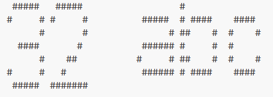
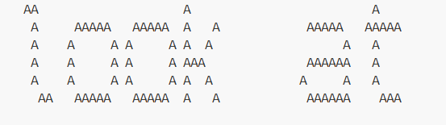
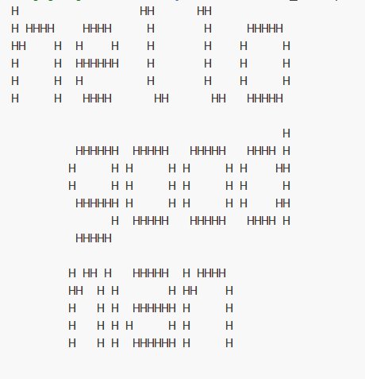
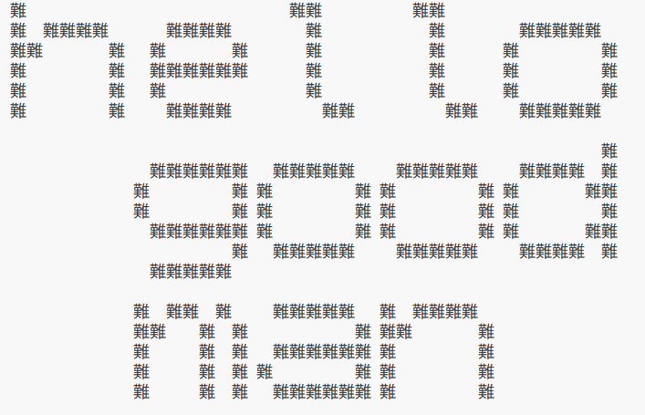

# robosys2026
ロボットシステム学2026の課題提出用のリポジトリ

# bigprintコマンド

標準入出力での入力やコマンドの後に続く文字列をアスキーアートのように特定の記号の並びで表現した物を出力する。

# 使い方:
./bigprint text
./bigprint -c '使いたい記号' text
のようにターミナル上で利用する
-c '使いたい記号' は省略可能(省略した場合は#で表示される)
表示に対応している表示テキストはアルファベット"a~z",数字"0~9",一部の記号".,!?()+-"などです。
'使いたい記号'の中身は文字や記号を1だけにしてください。(半角,全角文字共に入力可能)

# 実行例:
コマンド上での入力
実行例1: ./bigprint 32 abc                    

実行例2: ./bigprint -c 'A' look at                                         

パイプを使いファイル内の文字列を入力する                                          
実行例3: cat test_werd | ./bigprint -c 'H'　　　　　　　　　　　　　　　　　　　　　

実行例4: cat test_werd | ./bigprint -c '難'                                       

# セットアップ:
実行にはダウンロードし
chmod +x bigprint
などでパーミションを付与してください。
また、実行する時は必ずbigprintだけでなくletter_data.pyもダウンロードし同じディレクトリ内に入れてください。

## 必要なソフトウェア
- Python
  - テスト済みバージョン: 3.10〜3.14

## テスト環境
- Ubuntu 24.04 LTS

- このソフトウェアパッケージは、3条項BSDライセンスの下、再頒布および使用が許可されます。
- このパッケージの構成やコードの一部は下記のスライド（CC BY-SA 4.0 by Taro Suzuki）のものを、
  本人の許可を得て自身の著作としたものです。
    - https://github.com/tarolab-cit/lectures/tree/main/robosys2026
- © 2026 Keiji Fujie

